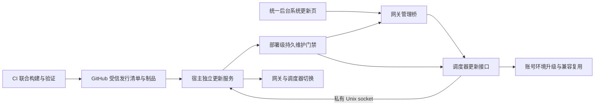

# 统一平台在线更新技术设计

## 1. 交付边界与架构

面向现有 Linux、Docker Compose、单机 SQLite 的 V3 部署，交付一次完整的“检查版本 → 管理员安装 → 排空切换 → 验收／恢复”闭环。自动检查、手动安装及短暂维护窗口均已由用户确认。

宿主更新服务采用 Python 标准库、OpenSSL Ed25519 校验和固定参数 Docker CLI，通过 systemd 单独托管。程序安装在 root 管理的独立版本目录，生命周期独立于 control 镜像。第一版固定更新服务版本，通过首次接入和专门运维升级。执行服务需要部署管理权限；权限范围以固定部署策略、路径、镜像仓库及操作协议约束。

浏览器沿用现有管理员鉴权及 `/runtime/` 会话桥；调度器通过私有 Unix socket 访问更新服务。只给调度器挂载 socket 目录。更新服务使用独立内部令牌、socket 权限和对端身份校验；令牌保存在首次接入生成的私有文件。浏览器只接触公开状态。

两个 control 服务额外挂载同一持久维护目录，只读访问；挂载目录而非单个文件，使原子替换可见。维护目录由更新服务写入，并位于独立私有状态根。更新服务只读既有部署配置，通过受限候选配置文件和原子切换完成版本提交。

本任务保持单一交付。发行合同、兼容改造、更新服务和页面共同构成可交付能力，各阶段采用同一验证矩阵。

## 2. 发行与信任合同

### 2.1 复用与新增

- 保留现有 `deploy/v3/manage.py` 的 schema=3 联合构建清单、真实镜像身份核验、按 registry digest 下载及同批镜像包。
- 新增平台更新外层合同 `system-release.json`，使用独立 Ed25519 发布密钥签名原始字节，签名为 `system-release.sig`。部署只安装公钥。内核签名合同继续独立维护。
- GitHub 精确发行标签拟为 `system-ci-<run_id>-<run_attempt>`，附件保留版本清单、签名和现有联合镜像包。固定仓库为 `SilentFlower/vibecoding-bench`。当前仓库已实际核对为 PUBLIC。
- CI 通过相关验证并完成全部制品发布后，才发布版本目录。每次构建产生唯一版本；管理员选择可用版本发起安装。
- GHCR 匿名读取能力在首次接入预检，失败可使用同一受信发行的完整镜像包。下载方式写入操作记录，现场凭据保持私有。

### 2.2 新增合同字段

以下字段均为拟新增合同，实施前建立 DTO 和严格校验器。

| 字段 | 语义与校验 |
| --- | --- |
| `schema_version` | 固定 1，未知版本拒绝 |
| `release`、`sequence` | 精确发行标签；CI run_number/run_attempt 的有序二元组，用于目录新鲜度检查 |
| `published_at`、`platform` | UTC 发布时间，首版固定实际支持的 linux/amd64；架构不符拒绝 |
| `build_manifests` | 按 control/account 分别引用其原 schema=3 清单的附件名、大小、SHA256；仍保留来源与精确批次证据 |
| `control`、`account` | 各自来源 release、完整提交、精确镜像引用、registry/config 摘要、content_sha256 及空间估算；源清单和镜像标签逐项对应。content_sha256 覆盖实际源码依赖，用于区分仅发布标签变化与账号内容变化 |
| `compatibility` | 更新服务最低协议、部署维护协议、桥接协议、隔离布局、CLI 安装协议、凭据所有权协议及允许的账号运行版本集合 |
| `data_compatibility` | bench/gateway 两库的迁移集合、目标版本、旧版读写兼容集合及已验证回退目标 |
| `changes` | 展示用变更说明及组件变化范围，有长度限制并按普通文本呈现 |
| `bundle` | 同批包附件名、大小、SHA256，对应现有发布包 |

外层合同允许声明经过验证的 control/account 混合组合；每个组件仍使用原始构建清单和镜像标签证明来源。禁止用宽松 release 比较替代兼容验证。旧 schema=3 纯命令行部署路径保留原严格语义，在线更新路径必须具备完整外层合同。

### 2.3 版本目录

固定通道只列当前 V3 受信发行，第一版自动每 6 小时检查，加入抖动；管理员可手动检查。自动检查只获取小型目录与清单，下载镜像由管理员安装或准备操作触发。

目录及其签名放置于固定仓库的专用 `updates/v3` 分支，单次 Git commit 同时发布两者。客户端先定位该分支的精确 commit，再使用相同 commit 的内容 API 获取两份原字节；发现位置只负责寻址，验签仍是信任依据。目录包含 schema、sequence、issued_at、expires_at 和精确发行清单引用。客户端保存最高已接纳 sequence；旧目录、过期目录及未知签名只更新错误提示，已安装记录继续保留。显式回退读取已验证历史合同，独立核对当前回退许可。

CI 发布通道采用串行并发组，更新前比对当前 sequence，旧 run 重跑只能发布自身唯一发行，不能将通道回退。先向草稿 Release 上传完整附件并核验，再正式发布，最后提交通道目录。通道引用推进失败时保留完整发行并报告未推广，后续恢复须按 sequence 校核。第一版目录默认有效期 30 天。使用独立目录分支，兼容发行附件发布后不可修改的仓库设置。

清单原字节上限 128 KiB、目录上限 256 KiB、签名精确 64 字节；拒绝重复 JSON 字段、非法类型、异常大小及未知必需能力。GitHub 内容 API 固定 `api.github.com` 及精确 owner/repo/ref，附件 HTTPS 来源和跳转白名单与内核下载原则一致；GHCR 按固定仓库和 digest 获取。下载前核对可用磁盘与签名声明的下载／解包空间，至少预留现行及恢复制品。

## 3. 版本身份与账号环境复用

`V3_RELEASE` 当前同时承担平台发布身份、镜像身份和运行绑定身份。新的在线更新路径将三者分开表达：

1. 平台安装记录保存所选发行及实际 control 来源摘要。
2. 账号环境保存其原始账号镜像来源 release、digest、已验证运行协议与环境代次。
3. sender binding 保存账号、环境、代次、秘密及环境原始版本身份；控制服务按已签名组合与实测协议核验。

既有归属核验继续包含 product、deployment、role、environment、generation。`allow_old_release` 仍只服务显式收口场景。正常复用只接受完整兼容证明。

旧环境首次接入时读取持久环境行、真实三角色标签、镜像配置身份和 sender binding，交叉核验后建立兼容记录；信息不全进入 reconcile。禁止将当前平台版本直接写为旧环境的真实来源。

- 仅控制服务变化、旧账号环境符合目标版本声明：保留角色容器、环境代次、HOME、资源与已选内核。
- 账号组件内容摘要一致时继续选择原受信镜像来源，通过单独的 `V3_ACCOUNT_RELEASE` 贯通两端绑定核验；每个环境的 root 私有 `runtime/account-image.json` 固化实际镜像 ID、来源与协议。未知内容变化采用保守重建。
- 目标要求更新账号镜像：安装计划列出受影响环境；全局排空完成后由目标调度器按原有受控生命周期逐个重建，已停止／退休环境保留状态，其未来启动使用已声明兼容的目标镜像。
- 每个环境在重建前持久记录原／目标实际镜像 ID、环境代次与维护意图。私有恢复动作额外接收两个受信镜像 ID，只收口同一 epoch、精确环境归属且无实际活动的部分角色。未知镜像和外来活动继续阻断。
- 每个环境记录原／目标引用、原始停止状态与阶段。中途失败时按兼容条件收口已变化环境，恢复结果完整记录。不能将“部分环境成功”报告为整次成功。
- 内核选择与账号镜像版本分别核对；镜像更新必须支持当前已选内核合同。需更换内核时在安装前提示并阻断不兼容组合，通过现有内核操作显式处理。

## 4. 部署维护与排空

### 4.1 持久门禁

新增部署级维护合同，包含 `schema_version/deployment/operation_id/epoch/phase/target_release/revision/created_at`。记录原子落盘并 fsync，目录 0700、文件 0600，拒绝符号链接及归属异常。

更新服务写入门禁后，分别请求 gateway/orchestrator 确认相同 epoch；两个服务在各自实际请求准入／作业认领锁内阻止新工作，并回报排空快照。文件写入本身不能称为完整接管。所有入口确认完成后再等待在途归零。

- 网关覆盖 API 路由选取及实际提交，阻止切换后的新请求进入；已准入请求自然完成。返回明确维护状态及可重试提示。
- 调度器覆盖普通任务、CLI、Pi、工程迭代、养号、恢复、评审、登录／重新授权和会写入凭据的后台动作；已认领的有限执行单元自然结束，下轮认领暂停。批次等待不持有活动计数，单项落库和有限执行分别参与准入。项目准备后的复查识别原有限调用链，继续核对时间窗和额度。
- 所有配置写入、账号生命周期写入及内核激活／恢复入口参与同一维护互斥。准备与观察按只读／制品写入范围单独校核。
- 现有准入门禁继续复核凭据归属、窗口、额度、租约和环境状态。部署门禁增加一层总准入，不能替代既有门禁。
- 维护期间允许管理员读取状态和执行本次操作的受证恢复动作；取消只在安全阶段释放本操作门禁。
- 排空快照先取调度器实际任务，再取网关完整流活动。原 CLI 尚在准备时，网关经内部受信接口只读核对原 owner 的实际登记后允许必要租约认领；原任务撤销后旧 owner 的迟到请求拒绝。新的登记与维护 ACK 使用同一准入锁。

首个可在线更新底座须同时具备 gate 协议 1。此后的所有可安装及可回退 control 版本都必须理解该门禁。启用更新功能的服务启动时先读取持久门禁；文件缺失、损坏或状态未知时暂停业务准入，保留诊断入口。

### 4.2 排空证明与超时

排空同时核对 gateway active/waiting、各 sender 活动、运行租约、环境 jobs、持久 execution、CLI/Pi 实际执行状态、评审交接和未知启动意图；身份、代次、epoch 逐项匹配。数据库无 running 行仅为一项证据。

首版等待期限默认 15 分钟，安装前可选 1～120 分钟并冻结在操作中。超时保持原版本，明确展示阻塞的账号和工作；本次门禁归属与旧版健康均明确时释放门禁恢复接单，否则进入 reconcile。第一版提供取消等待，强制终止工作列为后续能力。

现有 `/internal/v3/quiesce/{account_id}` 会停止环境，仅在需要环境收口时调用。控制服务更新复用旧账号环境采用新的只排空证明，保留空闲角色容器。

## 5. 更新操作协议与状态机

### 5.1 公开路径与请求合同

统一后台新增 `/updates` 路由，Vue 原生页面复用现有配色、卡片、按钮和响应式规则。通过已鉴权的 `/runtime/api/system-updates/...` 精确方法／路径白名单访问调度器，再由调度器访问更新服务。以下路径为拟新增接口：

| 方法与路径后缀 | 含义 |
| --- | --- |
| `GET /status` | 当前安装、实际组件版本、操作摘要、回退可用性、安装能力 |
| `GET /releases` | 最近已验证目录及缓存时间、检查错误 |
| `POST /check` | 发起异步版本检查，返回检查身份 |
| `POST /prepare` | 下载与校验候选；正常业务继续 |
| `POST /install` | 冻结目标并启动准备、排空与切换，返回 202 和 operation_id |
| `POST /rollback` | 重新核对明确目标及数据兼容后发起回退 |
| `GET /operations/{id}` | 持久阶段、完成项、阻塞原因、脱敏失败及恢复能力 |
| `POST /operations/{id}/cancel` | 下载／等待阶段安全取消，已进入切换返回冲突 |
| `POST /operations/{id}/recover` | 基于实际现场对账并恢复原版或完成已提交候选 |

写请求字段为 `operation_id`（UUID）、`expected_revision`、`target_release`、`target_manifest_sha256`、`drain_timeout_seconds`；取消／恢复另引用原操作 ID。未知字段、空 ID、过期现场、目标变化和跨部署请求拒绝。单实例部署策略固定目标数据根、配置路径、发布仓库、平台和公钥，浏览器不能传任意路径、env、URL 或命令。

同一 operation_id 和相同冻结参数返回原结果；同 ID 参数不符返回 409。完成后再提交旧 revision 同样返回 409。一次仅允许一个改变部署状态的操作。版本检查不更改安装 revision。

执行服务使用首次接入时固化的可信 Compose 模板，只允许合同声明的镜像引用和受控配置变化。远程发行不能提交任意 Compose 文本或宿主命令。目标需要新模板能力时，以最低更新服务协议阻断，先通过专门运维升级执行服务。

### 5.2 阶段

`preparing → prepared → draining → switching → verifying → committing → cleaning → succeeded`。

失败分支：准备失败／排空安全超时为 `failed`；切换或验收失败进入 `restoring → restored`；现场不明确为 `reconcile`；准备或等待阶段明确取消为 `cancelled`。`cleaning` 失败记录为 `succeeded_cleanup_pending`，保持新服务和重试清理入口。

宿主状态保存部署、原／候选完整组合、revision、阶段、原控制容器、环境逐项进度、维护 epoch、迁移证据、错误码、时间及已完成的副作用。先落意图再执行，动作后实测并落结果；文件及父目录同步。更新服务持有部署操作锁，实际变更阶段同时与现有 `.v3-storage-maintenance.lock` 互斥；复用管理函数时由唯一锁拥有者传递执行上下文，避免嵌套重复加锁。

### 5.3 实际切换与重启

1. 拉取／加载制品并核对签名、来源、镜像、兼容、磁盘及回退条件。
2. 持久维护门禁，获取两个服务的同 epoch 接管与排空证明。
3. 冻结环境及允许变更的元数据；关闭控制服务，按显式迁移合同处理数据。
4. 用候选配置只切换 gateway/orchestrator；禁止使用会遍历停止全部账号容器的通用 `stop` 路径。
5. 新控制服务在持久门禁下启动，先核对版本、数据、现有租约恢复及维护归属，再执行需要变化的账号环境。
6. 核对真实容器／镜像、管理桥、调度状态、账号身份和被动转发准备；默认验收使用零模型的本地／管理证据。
7. 原子提交安装记录，两个服务共同确认可恢复，再释放本次门禁。随后定向清理旧制品。

候选启动／控制验收默认上限 180 秒；账号生命周期动作使用其明确的单环境期限。超时转入恢复。维护时长以页面实际阶段和阻塞原因表示，首版不承诺零中断。

更新服务或宿主重启后根据持久阶段核对实际镜像与 gate，选择完成已提交结果、恢复原版或保持 reconcile。不得按“命令可能失败”重复切换。现有 `RuntimeLease::recover` 会将遗留租约标记为 reconcile，恢复流程只按本操作归属核对；外来租约继续阻断。

## 6. 数据兼容与回退

第一版仅允许目标及已验证原版能读取和继续写入迁移后数据的在线发行。独立安装记录及操作日志中的数据版本和迁移证据分别覆盖 bench/gateway，保存实际结构摘要、源码合同及受保护身份摘要；保留原有合法幂等迁移，增加显式变更集合与前置校验。相同源码数据合同下出现结构变化时拒绝验收。

发行端从实际迁移源码计算两库保守数据合同。默认只声明自身合同可回退；源码合同变化必须在代码审查过的 `system-update-policy.json` 中列出已验证旧合同。身份及软件字段的前后证据保存在本操作私有日志，按字段 CAS 收口；兼容许可不会从版本字符串推导。

- 部署安装记录和账号兼容元数据采用增量结构，验证旧版可忽略和保留未知字段。
- 已有账号画像启动同步单独列入迁移集合。软件字段变更须遵循既有画像选择规则；设备身份、凭据归属、资源和未知字段保持原语义。
- 若业务明确要求可逆的软件字段变化，只保存本次明确字段的受限前值及预期后值，按字段 CAS 校验恢复；保留记录私有权限。该记录不包含 OAuth 凭据，也不构造数据库副本。
- 不兼容的破坏性迁移、旧所有权协议或旧版不能读取的变更在切换前阻断，页面说明专项维护需求。
- 已选内核与原／候选账号镜像均需兼容。恢复原账号镜像之前再次核对全部依赖。
- 回退作为新的显式操作冻结当前 revision，经历同一维护与验收流程。恢复旧镜像后仍验证迁移账本、身份及真实运行版本。

US 保持原免备份及资源参数。在线更新不调用会触发通用资源重算或自动备份的路径；仍执行独立的端口、数据归属、制品身份、磁盘、兼容、任务与凭据所有权检查。

## 7. 页面与反馈

- 顶部显示当前平台发行、最近检查时间、检查结果和“检查更新”。
- 三个区域分别展示平台、账号环境、请求内核；账号环境显示实际分布和待升级数量，内核入口连接已有环境操作。
- 候选展示变更内容、涉及组件、需要重建的账号、兼容与回退条件。点击安装前展示维护影响、等待期限和冻结目标。
- 进度展示真实阶段、完成项和阻塞来源；刷新后从持久操作恢复，重复点击保持同一身份。
- 控制服务切换导致请求暂时不可达时显示“平台正在切换，正在重新连接”，串行退避轮询；连接恢复后读取原 operation_id。重连失败保留错误及本机恢复说明。
- 409 留窗并要求重新读取现场；取消／关闭确认框不发送安装请求。清理失败与服务恢复分别展示。
- 更新服务未安装时展示“需要首次接入系统更新底座”及运维说明，安装按钮保持不可用。

## 8. 制品保留与首次接入

成功后保留当前完整安装组合、最近两个完整历史组合、全部容器引用、内核选择引用和操作恢复依赖。每次删除前重新读取引用，仅精确删除受管镜像与制品。清理失败保留审计及重试能力。

首次接入工具在 dry-run 中盘点部署、数据、活动、现有身份和镜像；生成固定策略、独立公钥、私有状态目录、systemd 单元与 socket。CI 私钥由运维注入秘密存储。首次底座版本同时安装双端维护协议、兼容记录及页面；通过原部署流程单独批准上线。首轮完成后才开放页面安装能力。

首次 finalize 的状态提交和门禁释放支持同操作幂等续接。apply 与独立执行器共用服务锁，核对原发行、revision、epoch、配置和身份后完成原门禁释放。已有后来操作时拒绝覆盖。

当前暂停的生产部署继续由原指令约束，本任务先交付本地实现、隔离验证和首次接入操作说明。生产写入、外部密钥配置与首次服务安装均由后续明确操作指令承接。
